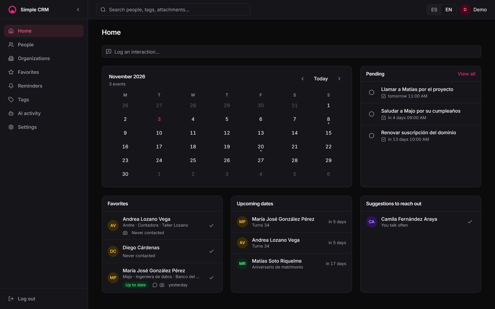
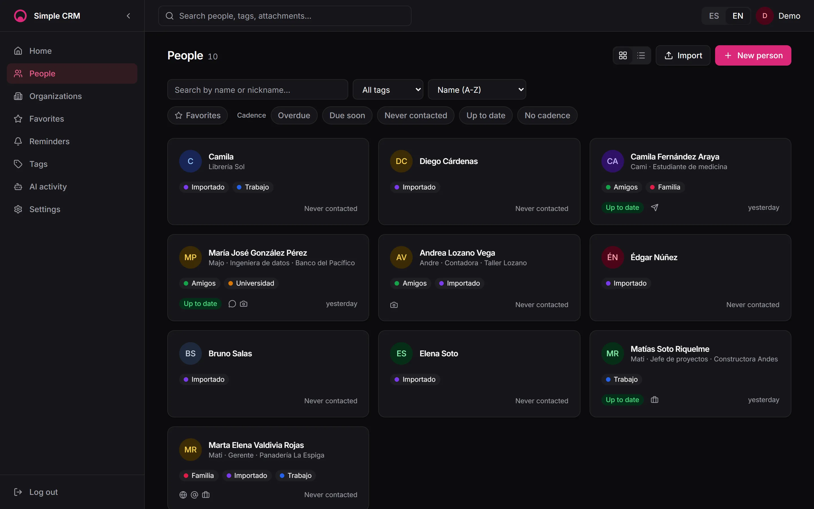
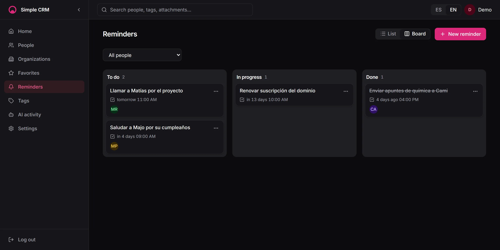
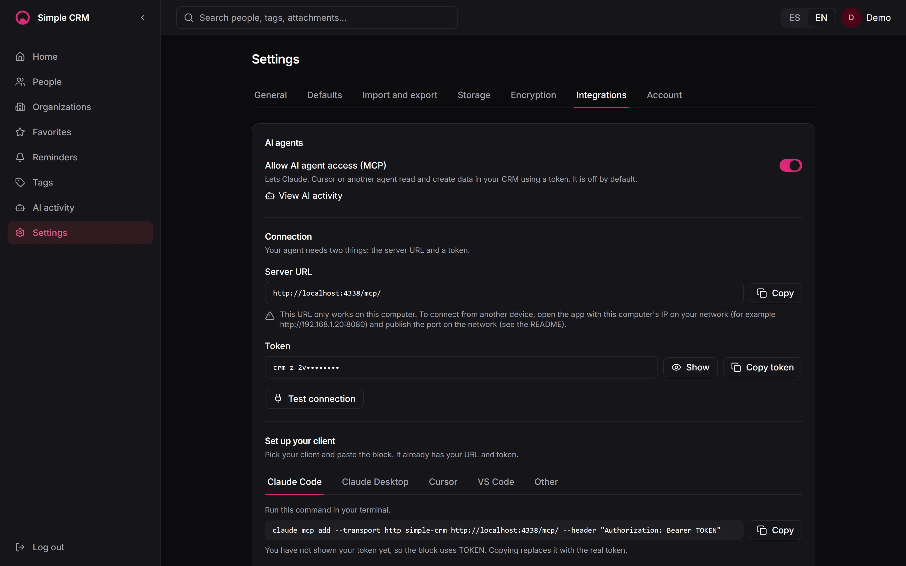
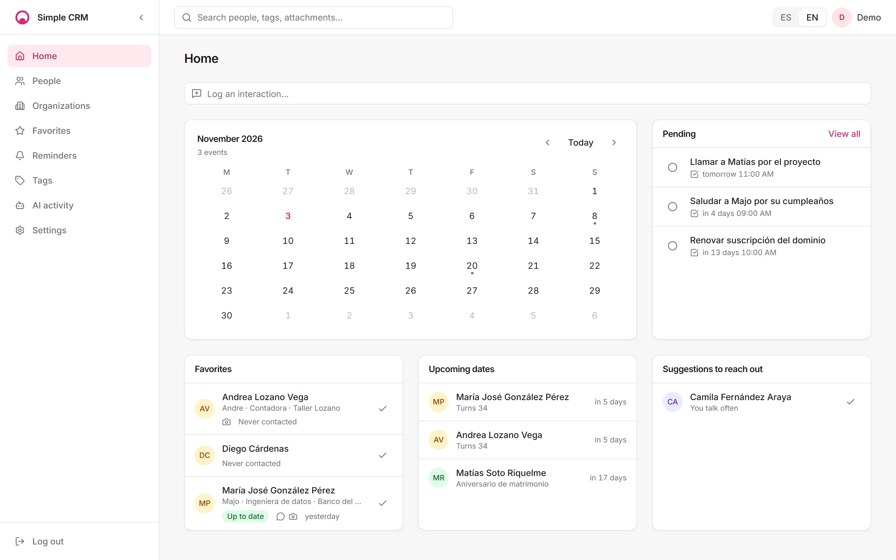

<p align="center">
  <picture>
    <source media="(prefers-color-scheme: dark)" srcset="docs/brand/kit/lockup-horizontal-white.svg">
    <source media="(prefers-color-scheme: light)" srcset="docs/brand/kit/lockup-horizontal-black.svg">
    
  </picture>
</p>

<p align="center">
  A self-hosted personal CRM to look after your relationships: people, important dates and reminders, with encrypted notes and attachments.
</p>

<p align="center">
  Website: <a href="https://simplecrm-eny.pages.dev/">simplecrm-eny.pages.dev</a>
</p>

## Features

- **People and contacts:** one record per person with several channels, tags, favorites, contact cadence and an interaction log.
- **Birthdays and important dates:** yearly dates with calculated age and an upcoming view.
- **Reminders and meetings:** statuses (to do, in progress, done), recurrence and a board view.
- **Organizations:** universities, companies and others, with logos and memberships.
- **Encrypted notes and attachments:** Fernet encryption at rest (see [Security](#security)).
- **Contacts import and export:** vCard (`.vcf`) and Google Contacts CSV, with duplicate detection.
- **AI agents via MCP:** Claude Code, Claude Desktop, Cursor or VS Code can read and create data with a revocable token.
- **English and Spanish UI**, light and dark themes, accent color of your choice.

## Screenshots

<p align="center">
  
  <br>
  <em>Home: calendar, pending reminders, favorites and upcoming dates.</em>
</p>

<p align="center">
  
  
  <br>
  <em>People (left) and the reminders board (right).</em>
</p>

<p align="center">
  
  
  <br>
  <em>AI agent access via MCP (left) and the light theme (right).</em>
</p>

## Quick start with Docker

Requires Docker with Compose v2 and Python 3 (only to generate secrets).

```bash
git clone https://github.com/Chaska-dev/SimpleCRM.git
cd SimpleCRM
python scripts/generate-secrets.py
docker compose --env-file .env.docker up -d --build
```

Then open http://127.0.0.1:8080 and create the first account at `/register/`. Registration closes after the first user; set `ALLOW_REGISTRATION=true` in `.env.docker` and recreate the backend to reopen it. On Linux or macOS the script may be `python3`.

## Configuration

`scripts/generate-secrets.py` creates `.env.docker` from `.env.docker.example` and fills the three secrets. The most important variables:

| Variable | Purpose | Default |
|---|---|---|
| `DJANGO_SECRET_KEY` | Django secret (sessions, CSRF), at least 32 characters. | Generated |
| `FIELD_ENCRYPTION_KEYS` | Comma-separated Fernet keys: the first encrypts, all decrypt. | Generated |
| `APP_PORT` | Host port of the proxy (published on `127.0.0.1` only). | `8080` |
| `SITE_ADDRESS` | Address Caddy serves: `:80` is plain HTTP, a domain enables automatic TLS. | `:80` |
| `CSRF_TRUSTED_ORIGINS` | Origins you open the app from (scheme, host, port). | `http://127.0.0.1:8080,http://localhost:8080` |
| `ALLOW_REGISTRATION` | `true` allows new accounts after the first one. | `False` |

Full variable list, LAN and domain access with TLS, and update, stop and delete instructions: [docs/configuration.md](docs/configuration.md).

## Connect an AI agent

The MCP server is optional and off by default. In the app:

1. Open **Settings > Integrations** and turn on "Allow AI agent access (MCP)".
2. Under **Connection**, copy the server URL and the token (press "Generate token" if there is none, and "Test connection" to check it).
3. Under **Set up your client**, pick Claude Code, Claude Desktop, Cursor or VS Code and paste the ready-made snippet, already filled with your URL and token.

A `localhost` URL only works on the same computer. To connect from another device, open the app through the computer's LAN IP and publish the port on the network (see [docs/configuration.md](docs/configuration.md#expose-on-your-network-or-a-domain)). Tools, security and limits: [docs/architecture/mcp.md](docs/architecture/mcp.md).

## Import and export contacts

Go to **Settings > Import and export**. Import a `.vcf` file exported from Android, iPhone (iCloud) or Google Contacts, or a Google Contacts CSV. You get a preview with duplicates before anything is written, and choose whether to skip, complete or create duplicates. Export to vCard or Google CSV, all contacts or one tag; notes are only included if you ask for them, and then leave unencrypted.

## Development

The database runs in Docker; backend (Django under uvicorn) and frontend (Astro) run on your machine.

```bash
docker compose up -d db          # Postgres on 127.0.0.1:5433 (docker-compose.override.yml)
```

Tests: `python manage.py test` in `backend/` and `pnpm typecheck` in `frontend/`. Local setup, demo data and the repository layout: [docs/development.md](docs/development.md).

## Security

- Sensitive text (notes, reminder messages, interaction bodies, "how we met") and all attachments are encrypted with Fernet. The key lives in `FIELD_ENCRYPTION_KEYS` in `.env.docker`, not in the database.
- **Back up `FIELD_ENCRYPTION_KEYS` outside the server.** If you lose it, encrypted data and backups cannot be recovered. See [docs/ops/encryption.md](docs/ops/encryption.md) for key rotation.
- A full backup is the database, the `media` volume and the keys, stored separately: [docs/ops/backup.md](docs/ops/backup.md). Passwords use Argon2, the login is rate limited and the containers run unprivileged.

## License

MIT, see [LICENSE](LICENSE).

<p align="center">Made with  by <a href="https://github.com/chaska-dev/SimpleCRM">Chaska Dev</a></p>
