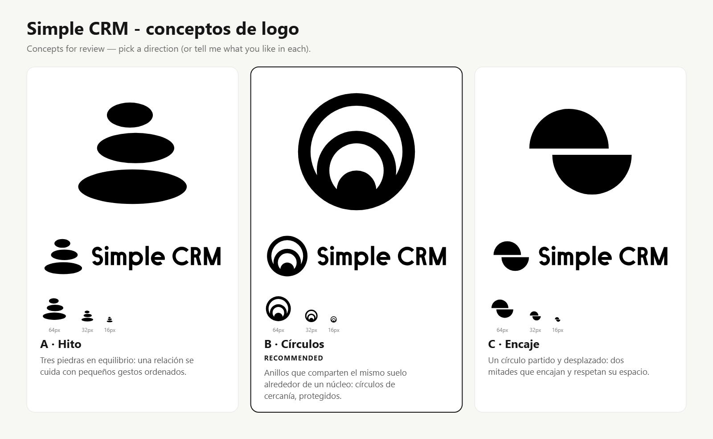

# Simple CRM - conceptos de logo (checkpoint, Fase G)

Proceso: skill `logo-design` (kaankiziltug/logo-design-skill, MIT), modo Design. Se detiene en el
checkpoint: tres conceptos en negro, sin kit completo. El kit se hace despues de elegir.

## Brief (tomado de spec-v4.md, Fase G)

- Nombre: "Simple CRM". La app permite renombrarla, asi que el simbolo debe funcionar solo (ningun concepto usa letras).
- Que es: gestor personal de relaciones (personas, cumpleanos, recordatorios, reuniones, instituciones), datos cifrados, agentes de IA opcionales.
- Audiencia: personas que cuidan sus relaciones personales y profesionales.
- Adjetivos: cercano, ordenado, confiable, sereno, privado.
- Evitar: silueta de persona, libreta, burbuja de chat, apreton de manos, candado literal, estilo generico de IA, gradientes.
- Debe funcionar: favicon 16 px, sidebar 24 px, icono de app, tema oscuro y claro, un solo color (`currentColor`).
- Presentacion: rosa `#db2777` sobre `#0b0b0e` y sobre blanco (todavia no aplicado: los conceptos van en negro).

### Supuestos

- Sin competidores concretos: se uso la biblioteca de la skill solo para estudiar la categoria (productividad, social, seguridad) y evitar sus convenciones (abstractos azules/multicolor, contenedores, "burbujas").
- La palabra "CRM" se compone en mayusculas y "Simple" con capital, como se escribe el nombre.
- Tipografia del lockup: sans geometrica monolinea construida a mano como trazados (sin fuentes, sin `<text>`). No es una fuente licenciada; es dibujo propio y provisional (ver pendientes).
- Decisor: el usuario.

### Estudio de la categoria

La biblioteca muestra que en productividad/social dominan abstractos multicolor, contenedores y negative-space; los marcos mas cercanos a mis ideas (PyTorch/CircleCI: aro con punto, Mastercard: dos circulos solapados, Dreamhost: luna creciente, Squarespace/Svelte: eslabones) se descartaron o se evitaron. Se descartaron tambien, por lectura equivocada en pruebas: aro con punto en el borde (parece notificacion/PyTorch), "cuenco con bola" (parece persona), semicirculo sobre barra (parece sombrero), vela (literal, estrecha), tarjeta con badge (generica), dos crecientes enfrentadas (parecen parentesis u ojos).

## Los tres conceptos

| | Concepto | Tipo | Idea (una linea) |
|---|---|---|---|
| A | **Hito** | pictorico/abstracto | Tres piedras en equilibrio: una relacion se cuida con pequenos gestos ordenados. |
| B | **Circulos** | abstracto | Anillos que comparten el mismo suelo alrededor de un nucleo: los circulos de cercania, protegidos. |
| C | **Encaje** | abstracto | Un circulo partido y desplazado: dos mitades que encajan y respetan su espacio. |

Adjetivos: A sereno, ordenado, confiable. B cercano, privado, ordenado. C ordenado, confiable, privado.

## Auditoria (`svg_audit.py`)

| Archivo | Score | FAIL | WARN | Anclas | Colores |
|---|---|---|---|---|---|
| concept-a-symbol.svg | 100/100 | 0 | 0 | 9 | 1 |
| concept-a-lockup.svg | 100/100 | 0 | 0 | 128 | 1 |
| concept-b-symbol.svg | 100/100 | 0 | 0 | 15 | 1 |
| concept-b-lockup.svg | 100/100 | 0 | 0 | 134 | 1 |
| concept-c-symbol.svg | 100/100 | 0 | 0 | 6 | 1 |
| concept-c-lockup.svg | 100/100 | 0 | 0 | 125 | 1 |

Sin `<text>`, rasters, filtros, gradientes ni trazos (todo relleno). Simbolos `viewBox 0 0 256 256`; lockups altura 256 (1022 x 256).

## Pruebas y refinados (3 rondas: v1 -> v4)

- Prototipos descartados tras ver miniaturas a 200/32/16 px (ver "Estudio").
- Wordmark: corregido un escalon de 1 unidad en la S (radios tangentes que no sumaban la altura), salientes de 0.6 unidades en la M, nariz de la barra de la e, escalon entre pata y asta de la R, junta asta/arco de la m; M ensanchada a diagonales de 70 grados.
- Encaje: desplazamiento reducido (56 a 44) para acercar el aspecto a un cuadrado (1.2:1).
- Circulos: anillos de 22 a 24 y nucleo de 36 a 38 para sobrevivir a 16 px.
- Hito: separacion entre piedras de 10 a 12 para que las tres se lean a 16 px.
- Vistas: `concept-*-symbol-16/32/64.png` (fondo blanco) y la hoja en escala de grises. La hoja de pruebas de la skill (`preview_sheet.py`: escala, pixel test, fondos, invertido, desenfoque, espejo/rotacion) se reviso; no se guarda en el repo.
- Lecturas no deseadas: A girado 180 grados parece un embudo (menor). B a 16 px puede leerse como diana/ojo/onda. C puede leerse como "S" o como yin-yang plano.

## Recomendacion

**B - Circulos.** Es el unico que cubre los cinco adjetivos con una idea que el usuario entiende (circulos de cercania: persona de confianza, amigos, conocidos), el nucleo protegido por anillos expresa "privado", y funciona como icono de app y con `currentColor`. Riesgos honestos: se parece a "diana"/onda; mitigacion: los anillos comparten suelo y el nucleo esta descentrado, lo que rompe la diana. A es la alternativa mas serena y distintiva en silueta (la mejor a 16 px y la mas diferente de la categoria), pero cubre menos "cercano" y "privado". C es el mas debil: la idea es mas abstracta y recuerda a patrones de "split circle".

## Pendientes / limites

- No es una busqueda de marca registrada: hacer busqueda de marcas e imagen inversa antes de usar.
- Letras del lockup dibujadas a mano, sin kerning optico final; se pulen tras elegir concepto.
- Color de presentacion (`#db2777`), version invertida con trazo adelgazado, texto del icono de app, favicon, kit y guia de uso: se hacen despues de elegir.
- El render PNG usa Chrome/Edge headless (unico backend disponible en este equipo).
